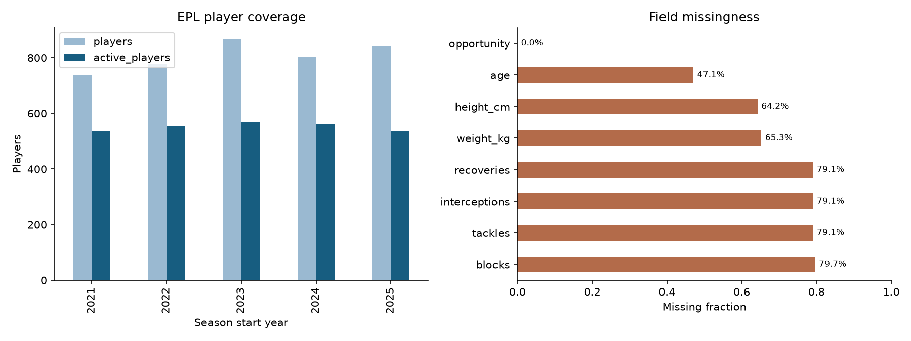
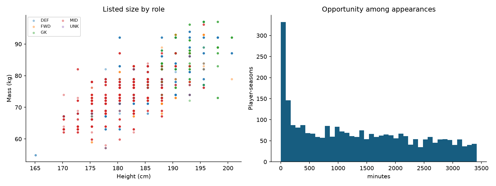
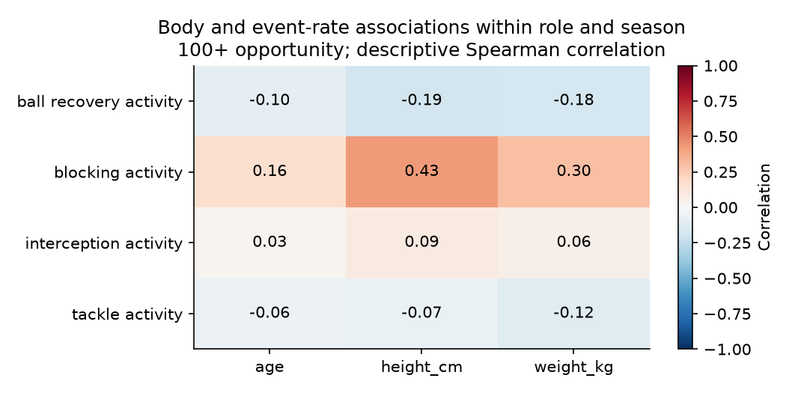

# EPL first data and model results

4,025 player-season rows; 1,797 distinct athletes.
Season start years: 2021, 2022, 2023, 2024, 2025. Opportunity unit: minutes.

## Coverage

| Season | Players | Active | Height coverage | Weight coverage |
|---|---:|---:|---:|---:|
| 2021 | 737 | 537 | 22.3% | 22.3% |
| 2022 | 778 | 554 | 28.8% | 28.5% |
| 2023 | 865 | 570 | 30.3% | 30.1% |
| 2024 | 804 | 562 | 39.3% | 38.7% |
| 2025 | 841 | 537 | 56.2% | 52.4% |

The correlation chart removes role/season means and requires 100 opportunity units. It describes association among already-selected athletes; repeated seasons are not independent athletes.

## Model evaluation

The 2024 season selects hyperparameters and the baseline/model choice. The 2025 season evaluates that frozen choice.
Returning-player candidates come from the prior season; nonreturners stay in availability and total-count evaluation.
Effectiveness rates are conditional on positive future opportunity. Total-contribution errors include nonreturners.
Forecast features use previous-season statistics, opportunity, role and age. Current physical listings are excluded.
Source snapshots contain final corrections; these are retrospective temporal tests, not point-in-time audited live forecasts.

| Target rate | Selected on 2024 | 2025 MAE | Persistence MAE | Role-mean MAE |
|---|---|---:|---:|---:|

## Physical compatibility

Status: trained.
Unseen-player test accuracy: 0.500; majority baseline: 0.413.
Balanced accuracy: 0.374. Body inputs: height_cm, weight_kg.
These probabilities describe role labels among elite athletes, not success probabilities for outside-sport candidates.

## Limits and interpretation

- The five-season FPL common core has no tackles, interceptions, recoveries, or blocks before 2025-26.
- The enhanced 2025-26 match archive publishes detailed events but no explicit open-data license.
- Public events do not measure pressures, pressing attempts, forced turnovers, or possession-adjusted opportunities.
- FPL role buckets do not separate center backs, fullbacks, holding midfielders, wingers, or pressing forwards.
- ESPN height/weight are post-season profile snapshots and must not be interpreted as annual measurements.
- Wingspan, arm length, and leg length are unavailable at league scale and remain missing.

See qa.json, season_coverage.csv, model_metrics.csv, split_manifest.json, and model_selection.json for evidence.
Raw data and fitted player predictions are local artifacts and retain their source terms.
