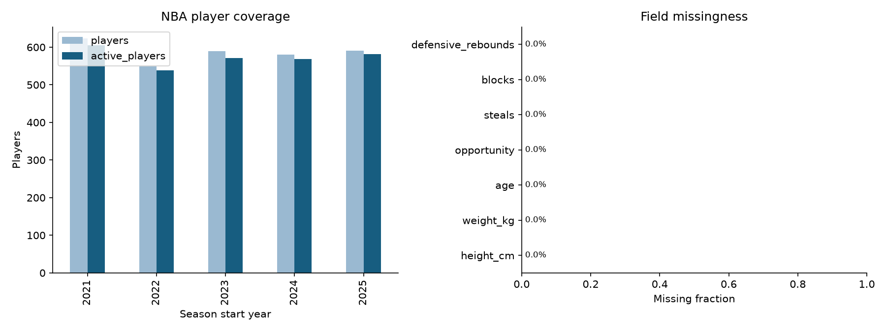
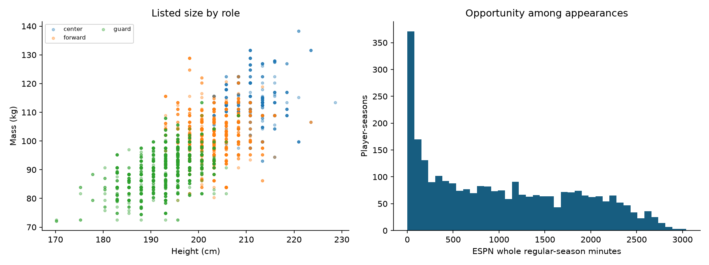
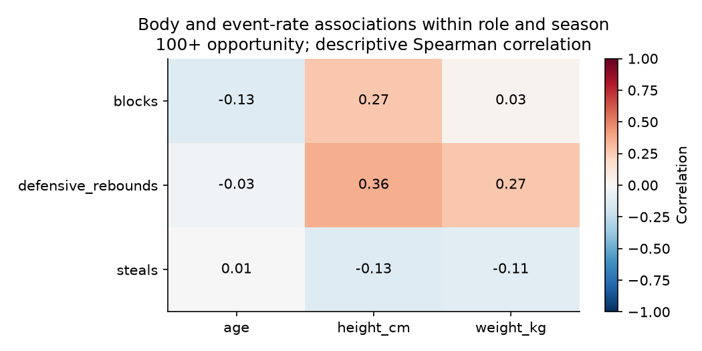

# NBA first data and model results

2,932 player-season rows; 1,057 distinct athletes.
Season start years: 2021, 2022, 2023, 2024, 2025. Opportunity unit: ESPN whole regular-season minutes.

## Coverage

| Season | Players | Active | Height coverage | Weight coverage |
|---|---:|---:|---:|---:|
| 2021 | 623 | 605 | 100.0% | 100.0% |
| 2022 | 549 | 539 | 100.0% | 100.0% |
| 2023 | 589 | 571 | 100.0% | 100.0% |
| 2024 | 580 | 569 | 100.0% | 100.0% |
| 2025 | 591 | 582 | 100.0% | 100.0% |

The correlation chart removes role/season means and requires 100 opportunity units. It describes association among already-selected athletes; repeated seasons are not independent athletes.

## Model evaluation

The 2024 season selects hyperparameters and the baseline/model choice. The 2025 season evaluates that frozen choice.
Returning-player candidates come from the prior season; nonreturners stay in availability and total-count evaluation.
Effectiveness rates are conditional on positive future opportunity. Total-contribution errors include nonreturners.
Forecast features use previous-season statistics, opportunity, role and age. Current physical listings are excluded.
Source snapshots contain final corrections; these are retrospective temporal tests, not point-in-time audited live forecasts.

| Target rate | Selected on 2024 | 2025 MAE | Persistence MAE | Role-mean MAE |
|---|---|---:|---:|---:|
| steals | ridge | 1.046 | 1.110 | 1.177 |
| blocks | persistence | 0.838 | 0.838 | 1.092 |
| defensive_rebounds | ridge | 2.380 | 2.647 | 3.395 |

## Physical compatibility

Status: trained.
Unseen-player test accuracy: 0.802; majority baseline: 0.557.
Balanced accuracy: 0.791. Body inputs: height_cm, weight_kg.
These probabilities describe role labels among elite athletes, not success probabilities for outside-sport candidates.

## Limits and interpretation

- Steals are direct possession changes; blocks are disruptions and defensive rebounds end opponent possessions. They are not interchangeable and are modeled separately.
- The public ESPN box score does not expose deflections, charges drawn, loose balls recovered, contested shots, matchup possessions, top speed or defensive tracking.
- ESPN minutes are rounded to whole minutes. Zero-minute rows can be a sub-minute appearance or a roster-coding ambiguity; explicit flags are retained.
- Historical SportsDataverse player_core files were regenerated from current ESPN profiles: reported age, experience, current team and status are not historical snapshots.
- Height and weight are undated profile values. Height is treated as an adult static descriptor; weight must not be interpreted as season-specific change.
- The 2026 NBA-ID crosswalk is current-season enrichment and is not comprehensive for players who left the league in earlier seasons; ESPN athlete_id remains canonical.
- All-Star exhibitions and NBA Cup championship games are removed even though ESPN labels them season_type=2; only each team's 82 standings games remain.
- No official NBA hustle/tracking enrichment is collected by default because the public website endpoints are undocumented and NBA reuse restrictions require separate review.

See qa.json, season_coverage.csv, model_metrics.csv, split_manifest.json, and model_selection.json for evidence.
Raw data and fitted player predictions are local artifacts and retain their source terms.
