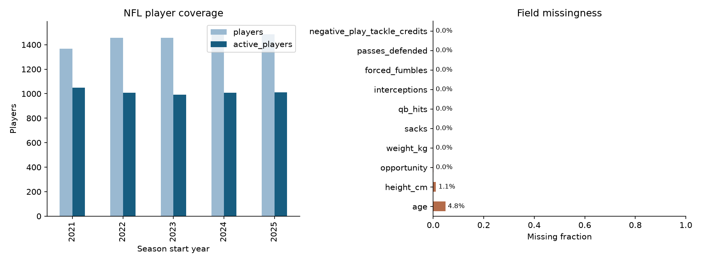
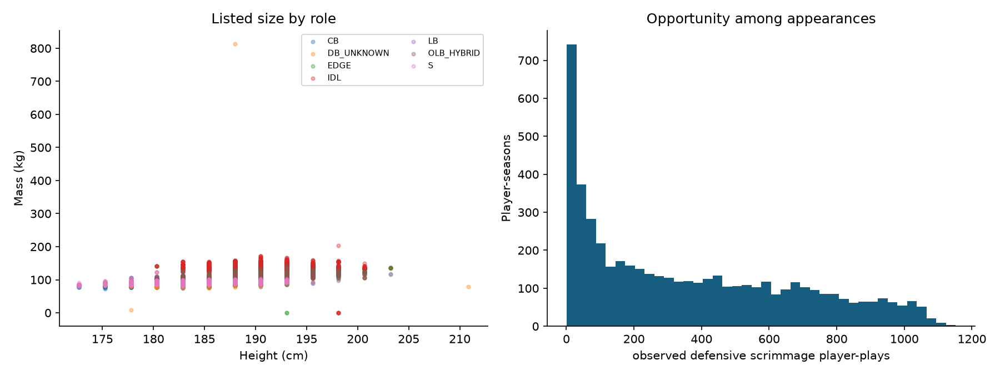
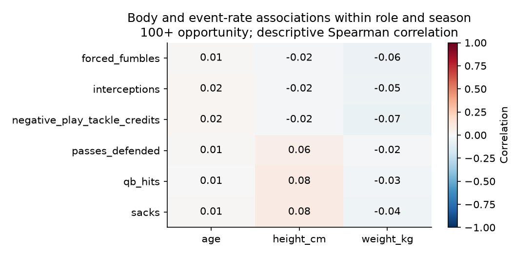

# NFL first data and model results

7,279 player-season rows; 2,754 distinct athletes.
Season start years: 2021, 2022, 2023, 2024, 2025. Opportunity unit: observed defensive scrimmage player-plays.

## Coverage

| Season | Players | Active | Height coverage | Weight coverage |
|---|---:|---:|---:|---:|
| 2021 | 1,368 | 1,048 | 100.0% | 100.0% |
| 2022 | 1,455 | 1,007 | 100.0% | 100.0% |
| 2023 | 1,456 | 993 | 100.0% | 100.0% |
| 2024 | 1,516 | 1,009 | 100.0% | 100.0% |
| 2025 | 1,484 | 1,011 | 94.7% | 100.0% |

The correlation chart removes role/season means and requires 100 opportunity units. It describes association among already-selected athletes; repeated seasons are not independent athletes.

## Model evaluation

The 2024 season selects hyperparameters and the baseline/model choice. The 2025 season evaluates that frozen choice.
Returning-player candidates come from the prior season; nonreturners stay in availability and total-count evaluation.
Effectiveness rates are conditional on positive future opportunity. Total-contribution errors include nonreturners.
Forecast features use previous-season statistics, opportunity, role and age. Current physical listings are excluded.
Source snapshots contain final corrections; these are retrospective temporal tests, not point-in-time audited live forecasts.

| Target rate | Selected on 2024 | 2025 MAE | Persistence MAE | Role-mean MAE |
|---|---|---:|---:|---:|
| sacks | ridge | 0.263 | 0.301 | 0.302 |
| qb_hits | ridge | 0.511 | 0.566 | 0.590 |
| interceptions | ridge | 0.100 | 0.109 | 0.106 |
| forced_fumbles | ridge | 0.126 | 0.138 | 0.136 |
| passes_defended | ridge | 0.463 | 0.582 | 0.475 |
| negative_play_tackle_credits | ridge | 0.498 | 0.603 | 0.526 |

## Physical compatibility

Status: trained.
Unseen-player test accuracy: 0.697; majority baseline: 0.197.
Balanced accuracy: 0.614. Body inputs: height_cm, weight_kg.
These probabilities describe role labels among elite athletes, not success probabilities for outside-sport candidates.

## Limits and interpretation

- Core opportunity counts observed non-no-play scrimmage participation, not exact pass-rush or coverage snaps.
- 2021-2022 participation is NGS; 2023-2025 is FTN. Provider effects are retained and rates remain exposure proxies.
- OLB usage cannot be reliably split into edge/off-ball; OLB_HYBRID is explicit.
- PFR pressures, coverage targets, missed tackles, snaps and combine data are stored separately and excluded from default models.
- Roster physical fields are archived listings, not verified yearly measurements; forecast models exclude them unless as-of validity is established.
- Sacks, hits and pass breakups overlap in football value; they are modeled separately and are not added into an unvalidated total.
- Default event counts are normalized PBP credits on the same valid scrimmage scope as participation; official weekly all-phase credits are preserved separately.
- PBP negative_play_tackle_credits are broader than pre-2024 official TFL. Official weekly TFL is stored separately and is not spliced into the target.
- Three 2025 player-seasons have uncovered event credits in participation. Their observed partial exposure is retained, but rate-model opportunity is null.
- All-rostered universe includes zero-opportunity players with known GSIS IDs; unresolved roster identities are quarantined.
- Anticipation/reaction/awareness are not directly measured by public box-score or participation data.

See qa.json, season_coverage.csv, model_metrics.csv, split_manifest.json, and model_selection.json for evidence.
Raw data and fitted player predictions are local artifacts and retain their source terms.
