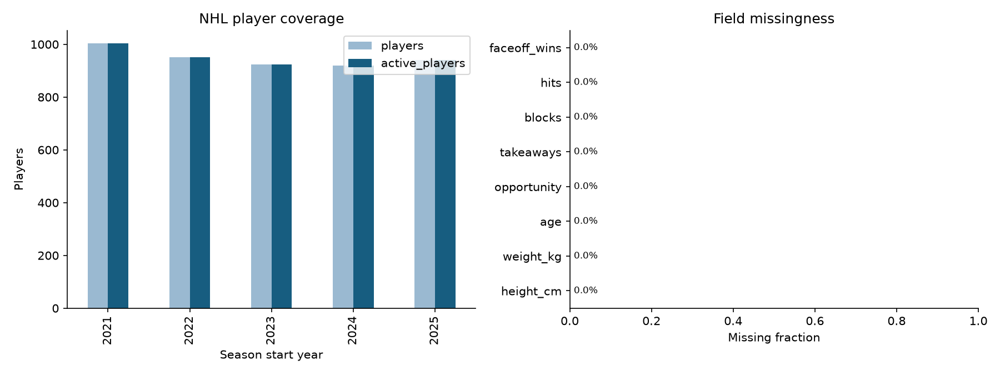
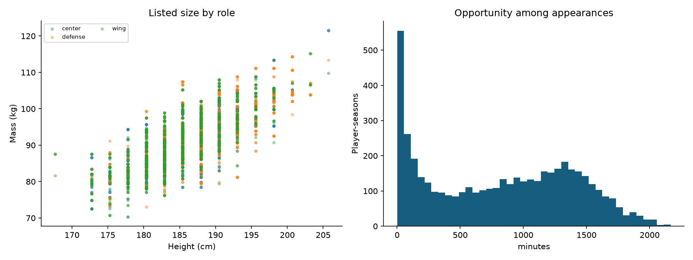
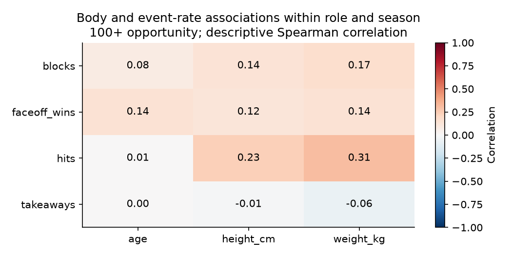

# NHL first data and model results

4,738 player-season rows; 1,480 distinct athletes.
Season start years: 2021, 2022, 2023, 2024, 2025. Opportunity unit: minutes.

## Coverage

| Season | Players | Active | Height coverage | Weight coverage |
|---|---:|---:|---:|---:|
| 2021 | 1,003 | 1,003 | 100.0% | 100.0% |
| 2022 | 951 | 951 | 100.0% | 100.0% |
| 2023 | 924 | 924 | 100.0% | 100.0% |
| 2024 | 920 | 920 | 100.0% | 100.0% |
| 2025 | 940 | 940 | 100.0% | 100.0% |

The correlation chart removes role/season means and requires 100 opportunity units. It describes association among already-selected athletes; repeated seasons are not independent athletes.

## Model evaluation

The 2024 season selects hyperparameters and the baseline/model choice. The 2025 season evaluates that frozen choice.
Returning-player candidates come from the prior season; nonreturners stay in availability and total-count evaluation.
Effectiveness rates are conditional on positive future opportunity. Total-contribution errors include nonreturners.
Forecast features use previous-season statistics, opportunity, role and age. Current physical listings are excluded.
Source snapshots contain final corrections; these are retrospective temporal tests, not point-in-time audited live forecasts.

| Target rate | Selected on 2024 | 2025 MAE | Persistence MAE | Role-mean MAE |
|---|---|---:|---:|---:|
| takeaways | ridge | 0.648 | 0.722 | 0.838 |
| blocks | ridge | 1.357 | 1.479 | 1.655 |
| hits | persistence | 2.687 | 2.687 | 5.883 |
| faceoff_wins | persistence | 2.793 | 2.793 | 6.592 |

## Physical compatibility

Status: trained.
Unseen-player test accuracy: 0.405; majority baseline: 0.371.
Balanced accuracy: 0.393. Body inputs: height_cm, weight_kg.
These probabilities describe role labels among elite athletes, not success probabilities for outside-sport candidates.

## Limits and interpretation

- Coverage is appearance-based; zero-game roster players are absent.
- MoneyPuck all-situations includes 5-on-5; the pipeline keeps the views separate.
- NHL bio height/weight measurement dates are unavailable and are not annual measurements.
- NHL EDGE top speed is not included: official pages expose leaderboards and per-player detail, not a supported full-roster bulk file; this baseline covers listed size and age, not current skating tests.
- League-wide NHL bios do not publish wingspan, arm length, or leg length.
- Public NHL data do not provide league-wide reaction time, agility, or cognitive tests.
- Takeaways are scorer-recorded events and do not capture every possession recovery.

See qa.json, season_coverage.csv, model_metrics.csv, split_manifest.json, and model_selection.json for evidence.
Raw data and fitted player predictions are local artifacts and retain their source terms.
